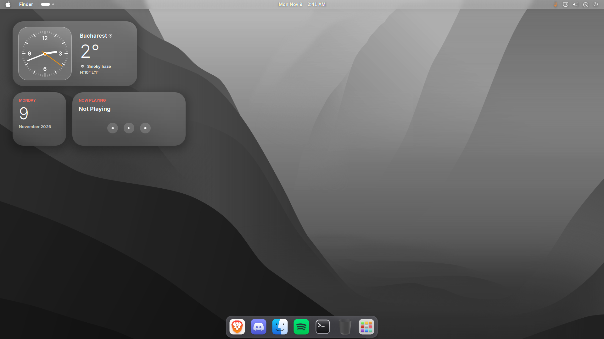
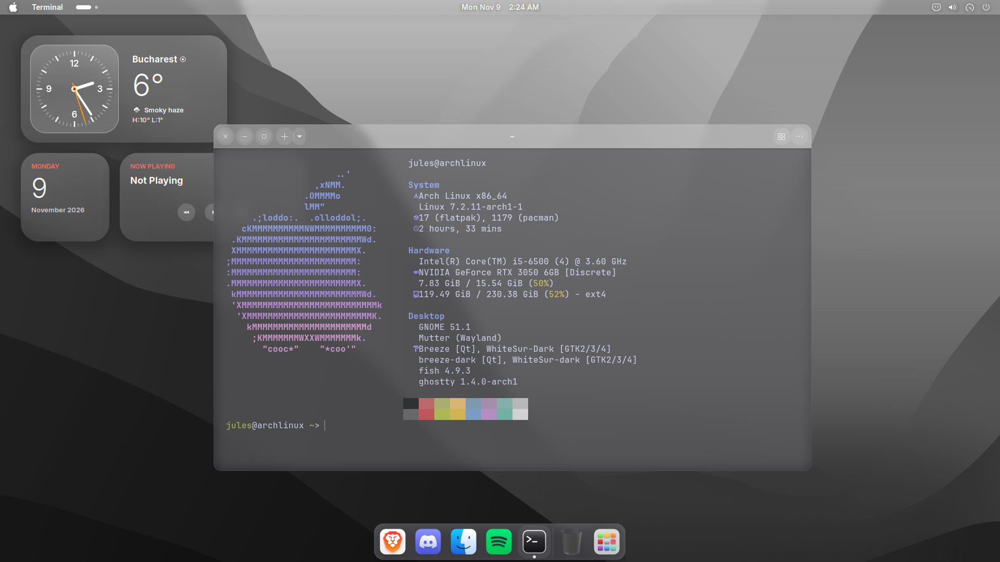
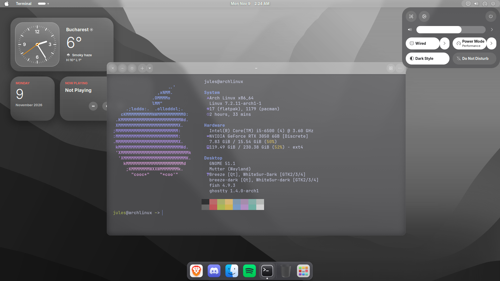
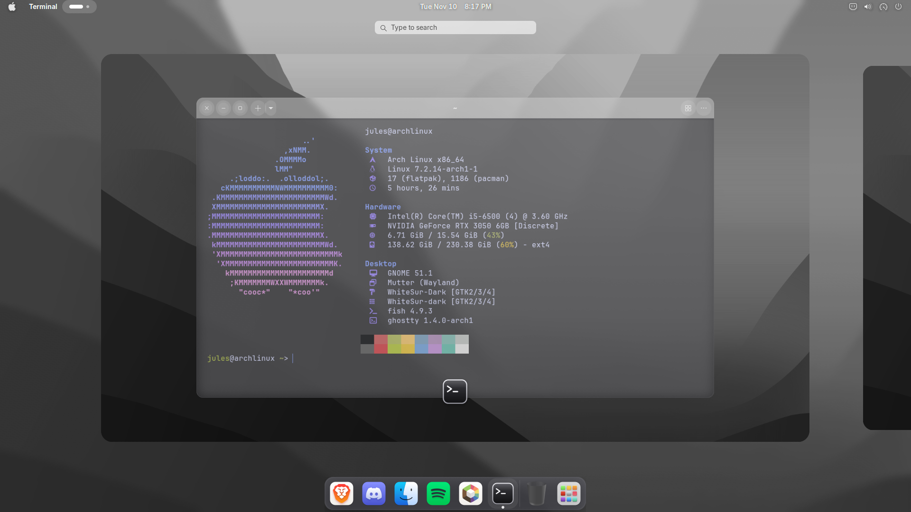

# ElRice - Rust soon!

Created by [@infectedwarelol](https://github.com/infectedwarelol).



ElRice is a liquid glass GNOME rice for Arch Linux that borrows the look of macOS and iOS without pretending to be either. The top bar, dock, Quick Settings, menus and apps sit on white frosted glass over your wallpaper, a StandBy-style clock and a few widgets live on the bare desktop, and the login screen and terminal match the rest. It runs as its own GNOME session with its own settings, so the desktops you already have stay exactly as they are.

| Terminal | Quick Settings | Overview |
| --- | --- | --- |
|  |  |  |

## Install

Clone the repo into the path the rice expects, then run the installer as your normal user. It asks for sudo when it needs it.

```bash
git clone https://github.com/infectedwarelol/ElRice ~/rices/gnome-macos
~/rices/gnome-macos/install.sh
```

The installer pulls in GNOME, the WhiteSur GTK, icon and cursor themes, Ghostty and the Inter font, then fetches the extensions that match your GNOME Shell version from extensions.gnome.org. At the end it asks whether to install the glass login theme for SDDM.

You need Arch or a derivative with `yay`, and SDDM as your display manager. GDM is not used. It was built and tested on GNOME 51.

## Use

Log out, pick **GNOME (macOS rice)** in SDDM and log in. Pick that session and not plain "GNOME", because the rice keeps its own dconf database and its own config folder in `~/.config-gnome-macos`.

Press Super+Space to search, Super to open the overview, and Super+Shift+S to take a screenshot.

## What it does

- **StandBy clock.** An analog clock and weather card on the desktop, with Calendar, Now Playing and Battery widgets underneath. Now Playing follows any music player and has its own controls. Everything hides behind your windows and only shows on the bare desktop.
- **Glass everywhere.** The top bar, dock, Quick Settings, menus, notifications, volume popups and GTK apps all sit on white translucent glass over a blur. Switches that are on turn solid white, like on iOS.
- **Overview.** Pressing Super blurs the wallpaper, but only when you have apps open.
- **Top bar.** Shows the name of the focused app next to the Apple logo.
- **Windows.** Rounded corners on every window and a Magic Lamp minimise animation.
- **Terminal.** Ghostty on smoky glass, with a fastfetch Apple logo in the rice colours.
- **Login screen.** A glass SDDM theme with a blurred wallpaper, a big clock and a pill-shaped password field.
- **Sounds.** A macOS-style sound theme for login, logout, screenshots and notifications.

## Make it yours

| What | Where |
| --- | --- |
| Weather city and unit | `standby.json` |
| Glass on the shell | `extensions/standby-glass@gnome-macos/stylesheet.css` |
| Glass on apps | `gtk/gtk-4.0/liquidglass.css` and `gtk/gtk-3.0/liquidglass.css` |
| Blur strength and tint | Blur my Shell preferences, pipelines "Classic Light Background" and "Overview Soft" |
| Terminal transparency | `background-opacity` in `ghostty/config` |
| Terminal logo | `fastfetch/config.jsonc` |
| Wallpaper | `wallpaper/wallpaper.jpg` |

GNOME on Wayland only reloads extension code in a new session, so log out and back in after you change the extension files.

## Performance

The top bar and dock use a static blur, which is blurred once instead of every frame. That keeps GNOME Shell light even with glass on every window. If an app still feels heavy, add its window class to the Blur my Shell applications blacklist so it renders without glass.

## Rust helper

`rust/spotify-debloat-check` is a small Rust binary that checks whether Spotify is already patched before the debloat script runs. That check used to start bash and Python on every Spotify launcher update; it now takes about 1 ms instead of 40 ms. Build it with `cargo build --release` inside `rust/` and copy `target/release/spotify-debloat-check` to `~/.local/bin`. The units in `systemd/` call it.

## Uninstall

```bash
~/rices/gnome-macos/revert.sh
```

It removes the session entry, the rice settings and config folder, the extensions it installed and the SDDM theme, then prints the packages it added so you can remove them yourself.

## If something looks off

- **The clock says "Weather unavailable".** The weather comes from wttr.in, so check that `curl https://wttr.in` works on your network.
- **The glass looks grey.** Make sure Blur my Shell is on and that you logged into the rice session.
- **A change does not show up.** Log out and back in.

## Credits

Built on the [WhiteSur themes](https://github.com/vinceliuice) by vinceliuice, [Blur my Shell](https://github.com/aunetx/blur-my-shell), [Search Light](https://github.com/icedman/search-light), Dash to Dock, Logo Menu, OpenWeather Refined, Media Controls, Quick Settings Tweaks, Compiz alike Magic Lamp Effect, Rounded Window Corners Reborn, [Ghostty](https://ghostty.org) and [fastfetch](https://github.com/fastfetch-cli/fastfetch). Weather by [wttr.in](https://wttr.in).
